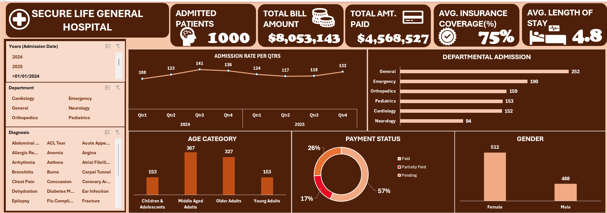

# SECURE LIFE GENERAL HOSPITAL PERFORMANCE DASHBOARD

## Introduction

This project is a hospital performance dashboard built in excel for Secure Life General Hospital. It analyzes patients’ admission across various departments, the outstanding medical bills and how the insurance coverage has influenced the operational and financial performance. The dashboard helps management monitor these performances and make informed decisions.

## About the Dataset

The Dataset ranging from 2024-2025 show a record of 1000 admissions over the year and this dataset consists of 1000 rows and 11 columns consisting of the; 
- **Patient ID:** Unique number for each patient visit.
- **Patient name:** Name of the patients
- **Age:** Patient’s age in years
- **Gender:**  Patient’s gender
- **Admission date:**  Date the patient was admitted 
- **Discharge date:**  Date the patient was discharged
- **Department:**  The department where the patient received treatment.
- **Diagnosis:**  The medical condition identified or recorded for the patient
- **Total Bill Amount:**  The total amount charged by the hospital for the patient's treatment and services.
- **Insurance Coverage (%):** The percentage of the total bill covered by the patient's health insurance. 
- **Payment Status:** Indicates whether the patient's bill is Paid, Pending or Partially Paid.
**Data Source:**[Click here](https://drive.google.com/file/d/1ducUbh6rfn2v_2ji4QEiCx1hENcvJHYS/view?usp=classroom_web&authuser=0)
I checked for duplicates, fixed the dates and the insurance coverage (%) which wasn’t formatted well, then I added some new columns to carry out the analysis which are;

- **Length of Stay:** This is the (discharge date – admission date), used to find the average length of stay across all admitted patients.
- **Insurance Coverage Amount:** Insurance Coverage (%) * Total Bill Amount.
- **Patient Responsibility:** The part of the bill the patient pays after insurance 
- **Paid Amount:** Calculated with an IF statement based on the Payment Status
- **Age Group:** Categorizes each patient into an age range, Children & Adolescents (0-17), Young Adults (18-34), middle-aged Adults (35-58) and the Older Adults (59+).

## Problem Statement

The management of Secure Life General Hospital has observed a change in patient admission, outstanding medical bills, and variations in insurance coverage across its departments. The hospital wants to use patient admission, billing and insurance data to understand its operational performance, monitor payments and improve management decision-making. However, the hospital currently lacks a consolidated report that provides a clear picture of its operational and financial performance.

## Visualization 

Microsoft Excel was used to create an interactive dashboard of the admission and billing trends of the secure Life General Hospital

## Insights

1. **Total Bill:** The total generated bill is $8,053,143
2.	**Admissions**: The total number of patients that was admitted between the period of 2024-2025 was 1000 
3.	**Busiest department**: The Department with the highest number of patients (252) is the General Department. The Emergency and Neurology department pays the best and the department with the most pending bills is the General department.
4.	**Highest Bill:** The Orthopedics department generated the highest total bill of $2,553,862 
5.	**Length of Stay:** The average length of stay of patients across different departments is 4.8 days, which is approximately 5 days 
6.	**Payment status:** The proportion of the payment status, fully paid, partially paid and the outstanding payment across various departments are 57%,26% and 17% respectively, which means that 17% of the total generated bill is yet to be paid to the hospital.
7.	**Outstanding Bill:** The hospital has billed $8,053,143 across the years, $4,568,526 was the total amount paid to the hospital leaving an outstanding fee of $3,484,616 which we do not know what part of it is the insurance or patient responsibility.
8.	**Insurance Coverage:** The average insurance coverage across various departments is 75% of the total generated bill of each patient.
9.	**Age Group:** The age group of the most visited patients falls under the middle-aged adults which are between the ages of 18-34 years.
10.	**Gender:** The hospital admitted a total number of 512 female patient and 488 male patients across the years.
11.	**Trend over time:** Admissions rose steadily through 2024, from 108 in Q1 to 123 in Q2 and a peak of 141 in Q3, then dropped slightly to 136 in Q4. In 2025 admission fell to 124 in Q1 and 117 in Q2, stayed almost the same at 118 in Q3, then recovered to 133 in Q4. Overall, 2024 recorded more admissions (508) than 2025 (492), and Q3 2024 was the busiest quarter.

## Management Attention

1.	General has the most patients but also a lot of outstanding fees, pending fee of 22% and partial payment of 28% of the total generated bill for the department.
2.	Emergency and Neurology collect best with about 60% of bills fully paid.
3.	About $3.4M of $8.05M billed has not been paid.

## Recommendations:

-	**Focus on the General department:** It admits most patients but have high pending (22%) and (28%) partially paid bills. Follow up on these payments faster.
-	**Learn from Emergency and Neurology:** Both have about 60% of bills fully paid. Management can study their billing and payment process and apply it in other departments.
- **Record partial payments:** Add columns for the amount paid by insurance and by the patient
- **Monitor the dashboard regularly:** To track pending bills and admission each quarter, so outstanding balances can be calculated exactly.
-	**Review insurance coverage by departments:** Coverage varies across departments so management should check where patients carry a larger share of the bill.

## Conclusion:

  This project turned the raw patient data of Secure Life General Hospital into an interactive Excel dashboard that shows its operational and financial performance. The hospital recorded 1000 admissions across 2024 and 2025 with an average length of stay of 4.8 days and average insurance coverage of 75%. Of the $8,053,143 billed, only $4,568,527 has been paid, which leaves a huge amount of outstanding bills. This analysis shows the payments collection, especially in the busiest department, need management’s attention. The dashboard gives management one clear view to monitor admissions billing and payment and to make better decisions. Tracking partial payments in future data would make the analysis even more accurate.

